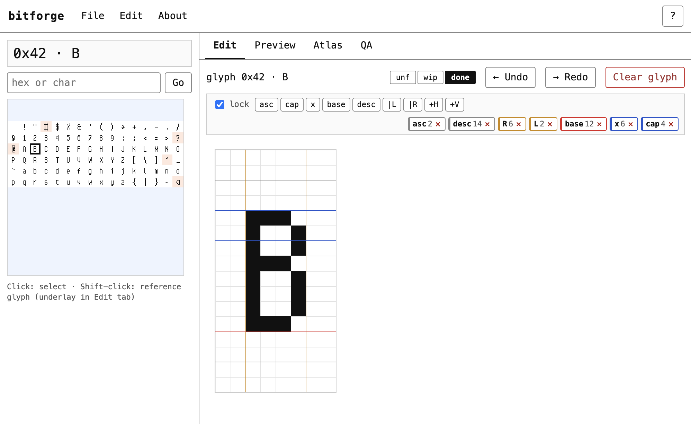

# bitforge

A **bitmap font editor** for fixed-size, zero-spacing, non-proportional **monospaced fonts** — 256 glyphs per face, cell size of your choosing (default 8×16).

Pure vanilla JS: no build, no dependencies, no server. Open `index.html` in a browser and it runs — straight from `file://`.



## Features

- **Bitmap editor** — click toggles a pixel, drag paints, right-drag erases; undo/redo; clear glyph.
- **Glyph selector** — the whole atlas as a 16×16 mini-glyph grid in the sidebar: click to select, **Shift-click** sets a *reference glyph*, drawn as a gray underlay behind the glyph being edited.
- **Guidelines** — per-font shared horizontal/vertical guides (ascender, cap, x-height, baseline, descender, left/right width) with presets, drag-to-move (lockable), drawn *between* pixels.
- **Preview** — a multi-line text sample with a small markup: `*bold*` (1 px double-strike), `_italic_` (slant with adjustable baseline), `\uXX` for unprintables, backslash escapes; scale 1–64; inverted (white-on-black) view.
- **Atlas view** — the whole face at a selectable scale, with bold/slant/inverted; click a cell to select it, right-click to set its status.
- **Glyph status** — mark glyphs *unfinished / wip / done*; the selector and atlas tint them. Pump through a face with `D` (cycle status) and `Shift+D` (mark done, move to next).
- **QA checks** — duplicate glyphs, edge-touching ink, guideline violations; per-glyph *silencing* for expected cases (box drawing, …) and a stale-aware report.
- **Import/export** — PNG atlas (file or clipboard), BDF, binary Verilog `$readmemb` ROM text, and a `.bitforge` project file carrying the work-in-progress state (guidelines, status, silences, settings).
- **Keyboard-driven** — glyph navigation, file ops, status pumping; press `?` in the app for the shortcut reference (rendered from the live binding registry, so it can't drift).

## Getting started

No install. Double-click `index.html` (any modern browser).

1. **File → New font** (default 8 wide × 16 high) or **File → Open PNG…** to import an existing atlas — a 16×16 grid of cells, so the image size must be a multiple of 16 in each dimension (the cell size is derived by dividing by 16).
2. Pick a glyph in the sidebar grid (or type its hex code / character in the jump field) and paint: click toggles, drag paints, right-drag erases.
3. Watch it live in **Preview** (multi-line sample) and **Atlas** (the whole face).
4. **File → Export …** — PNG atlas (solid white or transparent background), binary Verilog ROM text, BDF font, or a `.bitforge` project file.

The app also persists the current font and settings in `localStorage` automatically; use the project file for deliberate snapshots and the PNG for finished faces.

## File formats

### PNG atlas
256 cells in a 16×16 grid, row-major: the first row of cells is codes `0x00`–`0x0F`, the second `0x10`–`0x1F`, …, the last `0xF0`–`0xFF`.

- **Import:** dark pixels become ink — a luminance test that includes alpha, so both white *and* transparent count as "no ink" (a light checkerboard background imports fine).
- **Export:** ink is always black; the background is white or transparent, your choice. The File menu also has **Copy PNG to clipboard** / **Import PNG from clipboard**.

### Verilog ROM (`$readmemb`)
Plain binary text, no headers or comments: for each of the 256 glyphs, one row per pixel row, top to bottom; each row is a string of `0`/`1` bits with the **rightmost pixel as the MSB** (`1` = ink). Rows 1…H are glyph 0, the next H rows glyph 1, and so on. Binary rather than hex on purpose, so cell widths need not be multiples of 4 bits.

### BDF
Import and export, as an interchange with other bitmap-font tools.

### `.bitforge` project file
A JSON snapshot for work in progress: the font plus the things a PNG can't carry — editor guidelines, per-glyph status, QA silences, and app settings. The PNG remains the primary interchange for *finished* fonts.

## Preview markup

| Syntax | Meaning |
|--------|---------|
| `*text*` | bold — the glyph is struck twice, 1 px apart horizontally |
| `_text_` | italic — a cheap slant (1 px per 2 rows); the baseline is adjustable in the tab controls |
| `\uXX` | the glyph with hex code `XX` (for unprintables) |
| `\*` `\_` `\\` | a literal `*`, `_`, or `\` |

Newlines are line breaks (blank lines kept), markup state spans lines, and attributes can be nested.

## For developers

```
bitforge/
  index.html          # app shell: DOM, tabs, menus
  css/style.css       # styling (black-on-white, monospace)
  js/core.js          # PURE logic — model, exports, markup, slant, QA math (global BF, no DOM)
  js/app.js           # DOM wiring — editor, preview, atlas, menus, QA UI, settings, shortcuts
  test/               # headless unit tests (macOS JavaScriptCore, no Node)
  docs/               # handover documentation + screenshot (see below)
  AGENTS.md           # guide for AI coding agents
  LICENSE             # WTFPL
```

Run the tests — no Node, no browser, just macOS JavaScriptCore:

```sh
./test/run-tests.sh    # exit 0 = all pass
```

Documentation: [DESIGN.md](docs/DESIGN.md) (architecture) · [DECISIONS.md](docs/DECISIONS.md) (locked requirements) · [STATUS.md](docs/STATUS.md) (progress) · [TESTING.md](docs/TESTING.md) (test guide) · [AGENTS.md](AGENTS.md) (for agents).

## License

This project is licensed under the [WTFPL](LICENSE) (Do What The Fuck You Want To Public License, Version 2).

---

*Designed by spacecat · Coded by Qwen 3.8 (Bionic harness) · vanilla JS, zero dependencies, runs straight from file://*
